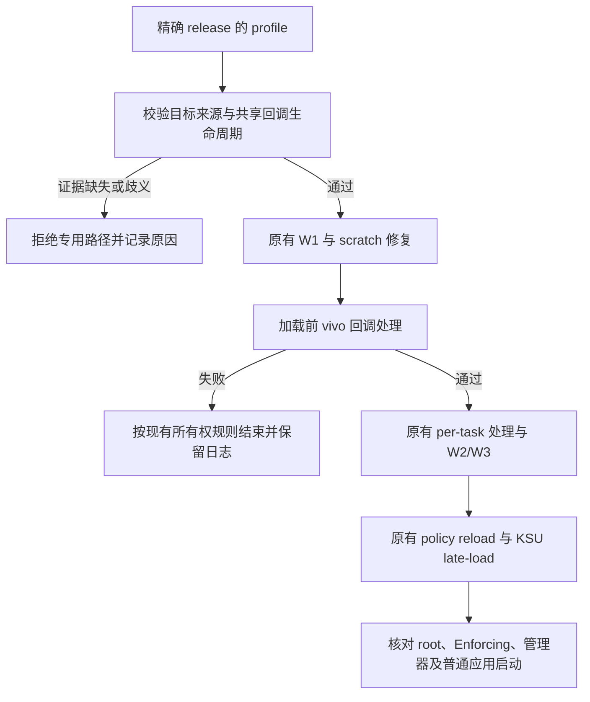

# iQOO 15 vivo 回调与 KSU 交接修复计划（2026-10-17）

## 现状与基线

分支 `main`，提交 `847793ea7f936c241f38f2ca840d382162ac5256`，源码版本计数 575。
调查前工作树干净。用户于 2026-10-17 认可设计并要求修改、改包名安装及导入旧配置。实施进行中。

旧 APK 的 SHA256 为 `d98adf1a2bba79a413811506c2d544956c7b9d56d95012fa723f9992a3a47438`。
已确认旧版 W1c 处理全局 `sys_exit` 回调，当前源码仅清除子进程标记。
24.7 的旧版成功日志与英文历史构建 569 已载入 KSU 的日志均已归档，后者不含 W1c。
这是一项高优先级原因假设，最终死机机制尚未由崩溃栈证实。
详细证据位于工作区 `analysis/diagnostics/ghostlock-20261017/分析结论.txt`。

## 目标与约束

让 iQOO 15 在临时 root 交接给 KSU 后维持应用启动和系统运行；成功标准包括实际应用可用性。
首批验证仅覆盖当前 24.7 的精确内核 release。偏移来源和结构布局必须有该版本证据。
使用现有 GLK1 v2 命名字段扩展数据，不新增 wire 版本、环境变量或全内存扫描。
旧版全局清零方案会影响共享 tracepoint 的其他消费者，实施前先复核 RCU、回调注册和
KSU 后续注册的生命周期；不能证明这一不变量时停止该批次，记录具体缺口。

## 改动清单

| 文件 | 拟改动与理由 |
|---|---|
| `src/core/profile/model.h`、`binary.cpp`、`accessors.hpp` | 加入有 presence 语义的 vivo 专用目标字段及校验，保持 GLK1 v2。 |
| `src/core/kernel/runtime_struct_offsets.h` | 如现有访问器布局需要，集中提供字段读取，避免执行层内散落偏移。 |
| `profile-core/src/main/kotlin/com/ghostlock/app/data/NativeProfile.kt` | 同步字段模型、导入、导出及二进制序列化。 |
| `profile-core/src/main/kotlin/com/ghostlock/app/data/profile/ProfileResolver.kt`、`ProfileExporter.kt` | 核对并仅在需要时补齐字段传递，缺失不补猜测值。 |
| `app/src/main/kotlin/com/ghostlock/app/data/AndroidProfileConfigController.kt` | 同步当前 HOCON 的识别与执行前校验。 |
| `src/core/session/backend/cve_2026_43499_backend.cpp` | 在已核验的加载前阶段处理 vivo 回调；保留 per-task 处理，失败不继续 late-load。 |
| `src/core/tests/profile_binary_test.cpp`、`profile_test.cpp`、`tests/host/backend_dataflow_test.cpp` | 验证字段缺失/越界、执行顺序和失败出口。 |
| `app/src/test/kotlin/com/ghostlock/app/data/NativeDocumentEquivalenceTest.kt`、`ProfileRoundTripTest.kt` | 验证 HOCON↔GLK1 字段保持与双侧一致性。 |
| `docs/kernel_profiles/PROFILE_SCHEMA.md`、`PROFILE_SCHEMA_ZH.md` | 记录字段用途、证据要求和缺失语义。 |
| `docs/analysis/device-gates/` | 保存每次成功或失败门禁，明确构建、入口和冷启动状态。 |

24.7 profile 先作为有来源的外部测试配置归档，真机通过后才考虑登记为内置支持。
提取器自动推导属于后续批次；没有该内核证据时保持未识别，不能用相邻版本默认值。

## 数据流与控制流差异

当前：W1/修复 → 子进程标记处理 → W2/W3 → policy reload → KSU late-load。
候选：执行前校验目标 → W1/修复 → 已验证的 vivo 回调处理 → 原有子进程/W2/W3 → 原有加载链。

KSU 已拥有 root 时保留现有提前返回；不对已加载 KSU 的共享回调做测试性清零。
waiter/race/payload 的指令与资源回收顺序保持原样。新步骤复用现有写操作和清理约定。

## 兼容性与回滚

仅对有验证证据的 vivo 专用配置启用，非目标设备维持原流程。
缺少字段时保留系统状态并拒绝该专用加载路径，不隐式复制旧版地址。
保留当前可用旧 APK、外部 profile 和全部原始日志；新构建验证使用独立归档。
回滚代码恢复本提交基线；内核内变更通过干净重启撤销，不尝试热卸载恢复共享指针。

## 验证矩阵

| 批次 | 验证 | 通过条件 |
|---|---|---|
| 0 | 24.7 镜像符号、BTF/布局或等价反汇编证据；旧 native 定向反汇编 | 目标与字段布局独立核实；共享回调的生命周期影响得到解释。当前 kallsyms 地址全 0，不能作为通过证据。 |
| 1 | Kotlin 单元测试；`make -C src native-host-tests` | profile 双侧字段一致，失败不进入加载步骤，旧 profile 行为明确。 |
| 1 | NDK 构建；`make -C src lint-tidy` | 零告警、0 findings。 |
| 1 | `python tools/cmp_disasm.py <原始源码基线二进制> build/native/ghostlock` | 8 个攻击函数严格相同或具名审查通过；另外复核新调用点及资源准备/回收相对顺序。旧 APK 已剥离符号，仅作为定向行为证据。 |
| 2 | 冷机、KSU 未加载、固定 CPU 对、select 单 route 真机门禁 | 记录 W1c、原有写验证、policyload、late-load、root 和 Enforcing；管理器及普通应用可正常启动。 |
| 2 | 同构建冷启动复跑与持续观察 | 不仅依赖 ready 日志；记录复现次数、运行时间、崩溃/阻塞栈；失败同样归档。 |

## 所有权与明确保留

现有 `ExploitSession`、`VictimContext`、route 继续持有各自资源；新校验只读取不可变 profile。
写请求使用同步调用期间有效的局部对象，route 的 prepare/execute/disarm/destroy 与隔离页回收顺序不变。
实现审查补充实际调用点的创建者、借用者、最后访问、终结点和释放者，逐条核查 UAF 与失败出口。
内核共享 tracepoint 的注册、读取和 RCU 回收必须单独列出生命周期；不能将其当成进程私有资源。

保留 `kernelsnitch/`、`LegacyProfileConverter.kt`、利用原语、模块加载脚本、管理器选择、UI 和其他 route。
本批次仅处理已有明确证据的 vivo 加载前差异。

## 进度

- [x] 读取仓库规范、源码和相关历史。
- [x] 只读采集设备与 17 次调试记录，确认当前 APK 哈希。
- [x] 定向反汇编确认旧 APK 的 W1c 分支，形成设计草案。
- [x] 用户认可本设计。
- [ ] 独立核验 24.7 目标布局及共享回调生命周期。
- [ ] 最小实现、主机检查与反汇编审查。
- [ ] 干净启动真机门禁与持续可用性确认。

## 用户确认后的安装隔离范围

用户指定 applicationId 为 `com.axuan.ghostlockapp`，安装并导入旧配置，保留旧应用。
追加修改 `app/build.gradle.kts` 的 applicationId 与 `GhostlockUserService.kt` 的独立工作目录。
Kotlin namespace 保留源码命名空间，组件类名继续正确解析；Shizuku authority 由 applicationId 派生。
只复制旧应用的 user_profiles 与相关偏好到新 UID，核对文件哈希、属主与 SELinux 标签；
新应用默认关闭 forced attack，避免在已有 KSU 的当前启动中重跑利用。
按用户补充要求离线分析 DFRoot 3.1；其 native、bootstrap 和内置模块单独保留证据。
