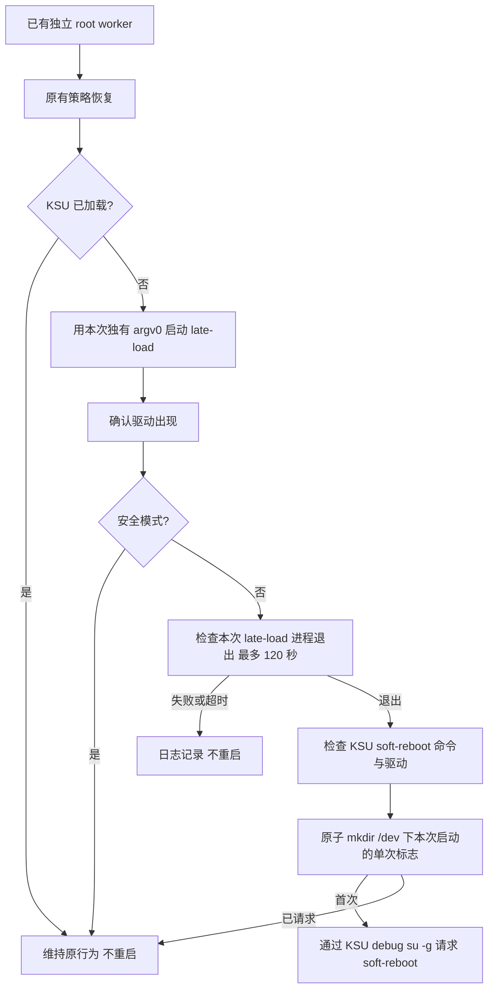

# KSU 提权收尾计划（2026-10-18）

## 现状与基线
基线 `eb6fa5e`，分支 very-not-stable-dev。root worker 执行 late-load，随后只确认 kernelsu 驱动。
本机 KSU 3.3.1 的 late-load 异步执行，且不跑 post-fs-data；完整 soft-reboot 会跑此阶段，Zygisk Next 在此初始化。
2026-10-18 用户认可“等待 late-load 收尾后自动完整 KSU 软重启”，要求本机 debug 签名安装，当前不重启。

## 目标与约束
首次提权后由独立 root worker 收尾，自动请求一次 KSU soft-reboot。安全模式、已有 KSU、启动失败、等待超时均退出收尾。
不改攻击原语、profile、Native/Kotlin 协议或模块。当前仅构建、模拟测试与安装；冷机真机门禁待用户允许重启。

## 改动清单
- src/core/attack/ksu_startup_script.hpp：只读 shell 片段，隔离异步等待与一次性重启逻辑。
- src/core/attack/ops.cpp：把该片段拼入现有 root 脚本，替换 late-load 调用并追加收尾。
- tools/test_ksu_startup.py：执行同一 shell 片段，用假 ksud/ps/驱动检查覆盖分支；无真实重启。
- README.md / README_ZH.md / src/core/README.md：描述新收尾行为及边界。
- 本计划：记录验证与未完成门禁。

## 数据流与控制流

argv0 仅标识本次 ksud，不按通用进程名猜测。进程枚举失败不推进。退出只表示该次 daemon 不再运行，不作为异步成功的凭据；后续再检查驱动、正式入口可用性。
重启经 KSU 自己的 root shell 和全局挂载命名空间执行，与 Manager 的调用路径一致；只在 stdin 传入一条 exec 指令，EOF 后不留交互 shell。
标志放 /dev，完整开机会清除，框架软重启保留。soft-reboot 请求失败不自动重试，避免循环。
root worker 已 setsid；所有 shell 状态由 worker 拥有。临时 ps 输出存在局部 shell 变量，退出释放；只读 C++ 字符串无动态析构。原有 victim、waiter、FD、凭据与 PI 资源生命周期不变。

## 兼容性与回滚
仅使用已对照的标准 shell、ps、KSU CLI。KSU 分支缺少 soft-reboot 时记录日志，不用普通 stop/start 替代。
安装覆盖同包名同 debug 签名应用；回滚只需安装前一 APK。无分区写入和启动脚本植入。

## 验证矩阵
- native-host-tests：现有全部主机测试。
- NDK 构建：零警告。
- lint-tidy：零 findings。
- cmp_disasm：对照修改前本地 binary，8 个核心函数形状一致，地址差异单列复核。
- shell 模拟：异步等待、超时、枚举失败、缺失驱动、CLI 失败、重复请求、安全模式、已有 KSU、正常单次请求。
- APK：核对 debug 签名、已安装 APK 哈希；安装前后 boot_id 与 system_server PID 不变。
- 真机提权门禁：当前明确未执行，不宣称完整验证通过。

## 明确保留
W1/W2/W3、所有 route、victim/PI 资源回收、SELinux 策略修复、kernelsnitch、profile/wire、HMA 和各模块均不改。

## 进度
- [x] 调查与方案，用户已授权此方向
- [x] 实现
- [x] 构建和相关检查完成；既有测试缺口见下文
- [x] debug 签名覆盖安装；启动标识、系统进程和应用 UID 均未改变
- [ ] 冷机提权真机门禁（本次不执行）

## 本次结果
- APK：`build/app/outputs/apk/debug/GhostLock-v1.2(578)-arm64-v8a-debug.apk`；使用本机 Android Debug 签名，与原安装一致。
- APK SHA256：`adfa014d421eee55d851cca866de37cee9e520d3124c18b1005e9a9ede4f6b23`。手机安装后的文件哈希一致；原位覆盖安装，UID 保留。
- NDK 构建成功，无 native 编译警告；完整 `lint-tidy` 通过，最终改动文件另行复查通过。其输出的系统头警告均被既有配置抑制，无用户代码 findings。
- 15 项 Android shell 模拟通过：正常、等待、超时、枚举失败、驱动缺失、命令不支持、重复请求、请求失败不重试、空进程表、claim 失败、解析失败、安全模式、KSU 已加载、late-load CLI 成功/失败。全部使用假 ksud、假驱动检查及临时 claim，未触发真实重启。
- 完整生成脚本通过手机 `sh -n`，长度在原 12288 字节缓冲区内。实际只读 `ksud debug su -g` stdin 协议验证通过。
- 原生测试：25 项在配置的 Linux 主机通过；TCP 测试原含未保护的 ARM `yield`，在 x86 无法编译。该项按原有 host 分支用 NDK 编译为 ARM 并在手机运行，构造/disarm/destroy 测试通过，没有启动攻击。Linux 临时源码与产物已清理。
- 原 `cmp_disasm.py` 的 6 个现存目标均形状一致，只存在 ADRP 地址标注变化；另外两个 multicast worker 符号在基线和候选中都不存在，原脚本因此返回 FAIL。另补核对两个现存 victim 入口，形状一致。逐条差异保存在 `build/ksu-soft-reboot/reviewed-disassembly.json`；未将旧脚本的缺失目标计为通过。
- JVM：80 项中 79 项通过；原 `ProfileMigrationEquivalenceTest` 的 legacy JSON 样本未覆盖当前所有 builtin profile，1 项失败。测试、样本、profile 资产和解析代码均未在本次修改，未扩散修复范围。
- 安装回报 Success。当前没有执行提权、系统重启或系统界面重载。真实“干净开机→提权→自动 KSU 软重启→Zygisk/HMA 生效”的门禁仍待用户允许，不宣称已通过。
- 本地日志、安装核验与原 APK 位于忽略的 `build/ksu-soft-reboot/`。原始日志与安装资料不纳入源码提交。
